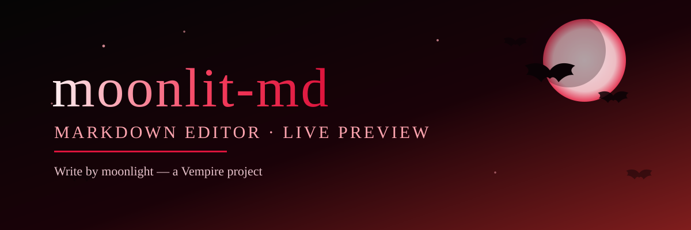

# moonlit-md

A Vempire-themed markdown editor with a safe live preview, word count, reading time, and one-click HTML export.

## Features

- Live preview as you type, powered by a small hand-written markdown renderer
- Safe by design: raw HTML is escaped first, so `<script>` and friends never pass through
- Supports headings, **bold**, *italic*, inline code, fenced code blocks, links, lists, and blockquotes
- Word count, reading time, character and line stats update in real time
- Download the rendered output as a standalone HTML file, or copy the HTML to the clipboard
- Dark crimson/black glass UI with bat motifs — no build step, no dependencies

## Usage

Open `index.html` in a browser (or serve the folder with any static file server) and start writing in the left panel. The preview updates instantly.

- **Sample** loads a starter document, **Clear** empties the editor
- **Copy HTML** copies the rendered HTML fragment
- **Download HTML** saves a complete standalone HTML document

## Tests

Requires Node.js 20+.

```bash
node --check app.js
node --test
```

The tests cover rendering basics (headings, emphasis, code, links, lists, blockquotes), HTML escaping (including `<script>` injection attempts), word counting, and reading-time estimation.

## License

MIT — see [LICENSE](LICENSE). Copyright (c) 2026 Lavish Gangwar.
